

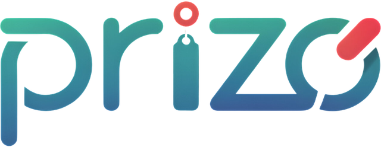

# پرایزو، دستیار خرید شما

**پیش از هر خرید بدانید قیمت امروز واقعاً خوب است یا نه.**

پرایزو قیمت امروز را با ۳۰ روز گذشته می‌سنجد، کالاهای دلخواهتان را زیر نظر می‌گیرد و وقتی قیمت یا تخفیف به شرط شما رسید خبرتان می‌کند.

[🌐 وب‌سایت](https://prizoai.ir) · [🧩 افزونهٔ مرورگر](https://chromewebstore.google.com/detail/prizo/badnjhkoepmmgmffcoloclogblcbomjb) · [📱 اپلیکیشن اندروید](https://github.com/zanasaed/prizo-extension/releases?q=android-v&expanded=true) · [✈️ آموزش‌ها در تلگرام](https://t.me/PrizoAi) · [📸 اینستاگرام](https://www.instagram.com/prizoai)

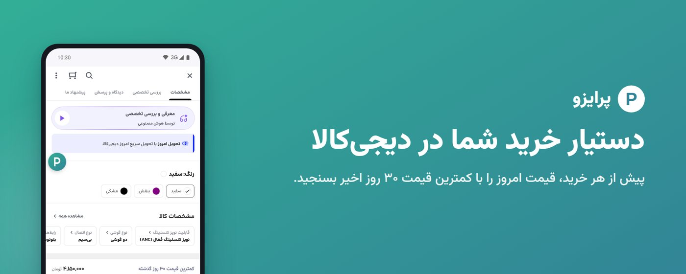

## پرایزو چه کار می‌کند؟

تخفیف بزرگ روی برچسب همیشه به معنی قیمت خوب نیست. گاهی کالایی ماه‌هاست با همین «تخفیف» فروخته می‌شود. پرایزو کنار قیمت هر کالا نشان می‌دهد در ۳۰ روز گذشته چقدر بوده، و اگر هنوز وقت خرید نرسیده، قیمت را برایتان زیر نظر می‌گیرد.

- **قیمت امروز را بسنجید.** کمترین قیمت ۳۰ روز اخیر کنار قیمت کالا می‌آید، با یک جمله که می‌گوید امروز ارزان است، معمولی است یا گران.
- **صبر کنید، پرایزو می‌پاید.** شرط خودتان را بگذارید، مثلاً قیمت هدف یا درصد تخفیف. وقتی برقرار شد اعلان می‌گیرید.
- **سبد خرید را ارزان‌تر ببندید.** پیش از پرداخت ببینید فروشندهٔ دیگری همین کالا را ارزان‌تر دارد یا نه.

پرایزو دو شکل دارد: **افزونهٔ مرورگر** برای کامپیوتر و **اپلیکیشن اندروید** برای موبایل. هر دو رایگان هستند.

## کدام را نصب کنم؟

| | افزونهٔ مرورگر | اپلیکیشن اندروید |
|---|---|---|
| مناسب برای | خرید با کامپیوتر | خرید با گوشی |
| فروشگاه‌ها | دیجی‌کالا و چند فروشگاه دیگر | دیجی‌کالا و دیجی‌کالا فرش |
| کمترین قیمت ۳۰ روز اخیر | ✅ | ✅ |
| لیست نظارت و هشدار قیمت | ✅ | ✅ |
| پایش یک صفحهٔ جست‌وجو یا دسته‌بندی | ✅ | ✅ |
| سبد هوشمند | ✅ | ✅ |
| معادل ساعت کار | ✅ | ✅ |
| شگفت‌انگیزها | ✅ شش فروشگاه | ✅ دیجی‌کالا و فرش |
| پایش تخفیف سوپرمارکت | ✅ | ❌ |
| فیلتر پیشرفته، مقایسهٔ تنوع‌ها، تحلیل سفارش‌ها | ✅ | ❌ |
| نمودار تغییر قیمت | ✅ | ❌ |
| مقایسه در ترب | ✅ | ✅ |

---

## 🧩 افزونهٔ مرورگر

پرایزو روی خود صفحه‌های فروشگاه کار می‌کند. چیزی جدا باز نمی‌کنید، اطلاعات کنار همان قیمت‌هایی می‌آید که می‌بینید.

**[⬇️ نصب از فروشگاه کروم](https://chromewebstore.google.com/detail/prizo/badnjhkoepmmgmffcoloclogblcbomjb)**

نصب و به‌روزرسانی افزونه فقط از همین فروشگاه رسمی انجام می‌شود و نسخه‌های تازه خودکار می‌رسند.

### ابزارها

#### تخفیف واقعی است؟
زیر قیمت کالا یک جمله می‌بینید که قیمت امروز را با ۳۰ روز گذشته مقایسه می‌کند: کمترین قیمت، نزدیک کمترین، معمول یا گران‌تر. اگر سابقهٔ کافی نباشد، چیزی نشان داده نمی‌شود.

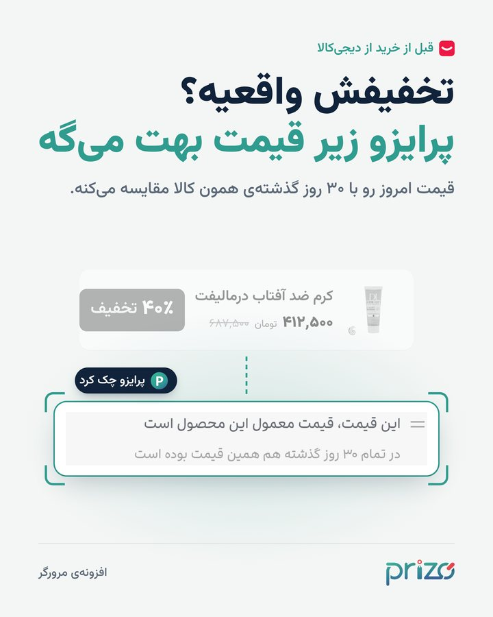

**چه فایده‌ای دارد؟** با تخفیف‌های نمایشی فریب نمی‌خورید.

#### لیست نظارت و هشدار قیمت
کالا را به لیست نظارت اضافه کنید و شرطتان را بگذارید: قیمت هدف، حداقل تخفیف یا رسیدن به کمترین قیمت ۳۰ روز. هر چند وقت یک بار خودش بررسی می‌کند و فقط وقتی شرط برقرار شد اعلان می‌دهد. نمودار تغییر قیمت هم کنار کالاست.

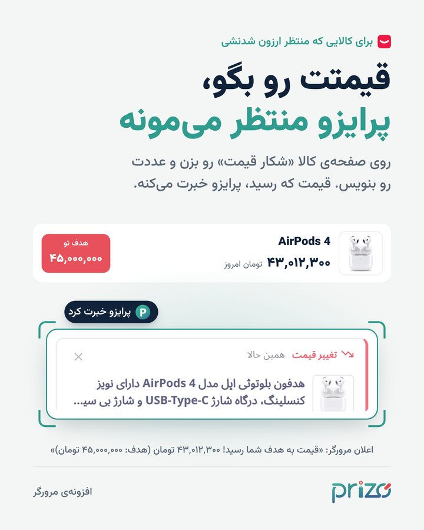

**چه فایده‌ای دارد؟** لازم نیست هر روز سراغ یک صفحه بروید.

#### پایش صفحه
به‌جای یک کالا، کل یک جست‌وجو یا دسته‌بندی را با همان فیلتر و مرتب‌سازی زیر نظر بگیرید. پرایزو کالاهای اول فهرست را بررسی می‌کند و هر کدام به شرط شما برسد، نشانتان می‌دهد.

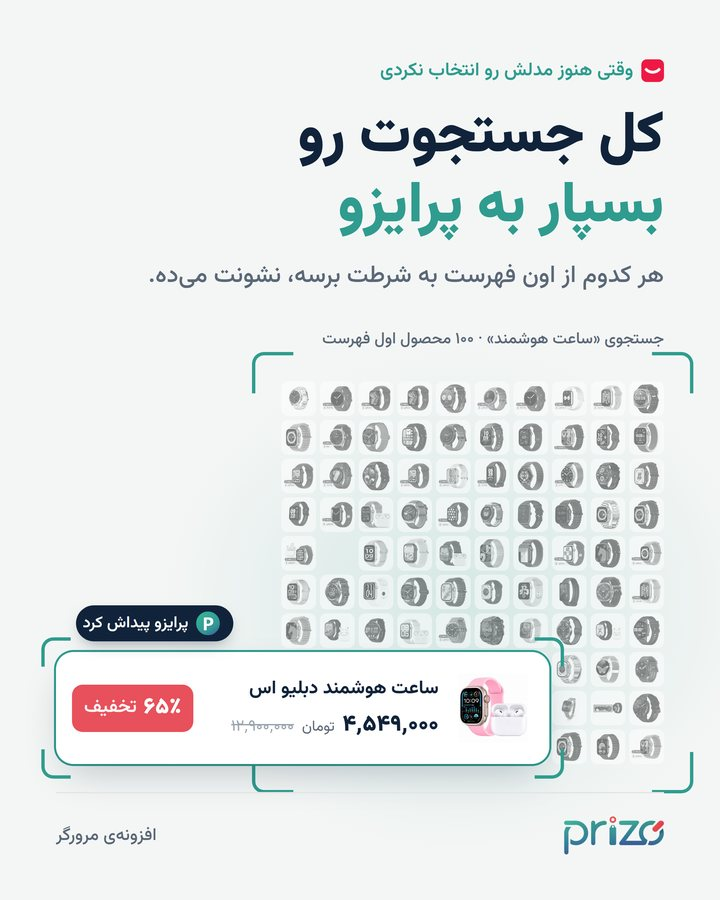

**چه فایده‌ای دارد؟** وقتی هنوز مدل مشخصی انتخاب نکرده‌اید، پایش یک کالا کافی نیست.

#### سبد هوشمند
فروشنده‌های هر کالای سبد را با هزینهٔ ارسال مقایسه می‌کند و اگر ترکیب ارزان‌تری باشد، پیشنهاد می‌دهد. هر تغییر را خودتان تأیید می‌کنید.

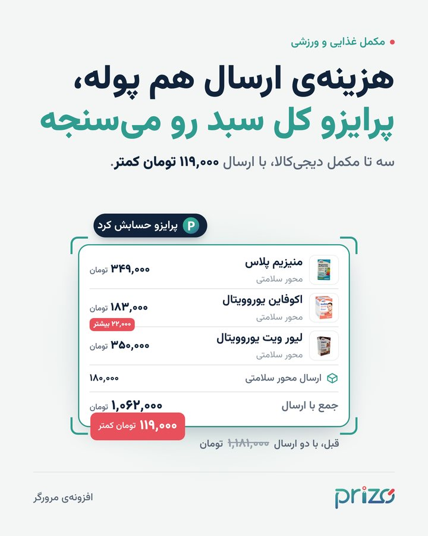

**چه فایده‌ای دارد؟** همان سبد را با مبلغ کمتر می‌بندید.

#### نگاه آخر پیش از پرداخت
زیر هر کالای سبد می‌بینید آیا ارزان‌ترین پیشنهاد را انتخاب کرده‌اید و کمترین قیمت ماه گذشته‌اش چقدر بوده است.

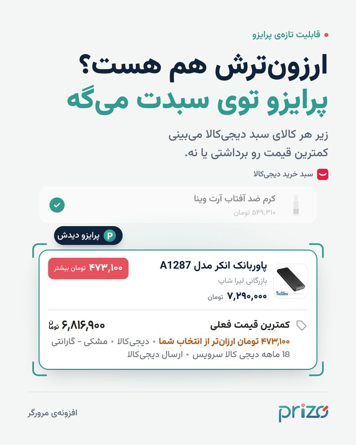

**چه فایده‌ای دارد؟** اگر فروشندهٔ ارزان‌تری بوده، در آخرین قدم متوجه می‌شوید.

#### مقایسهٔ رنگ‌ها و فروشنده‌ها
در صفحهٔ کالا همهٔ گزینه‌ها را، از ارزان‌ترین، کنار هم می‌بینید.

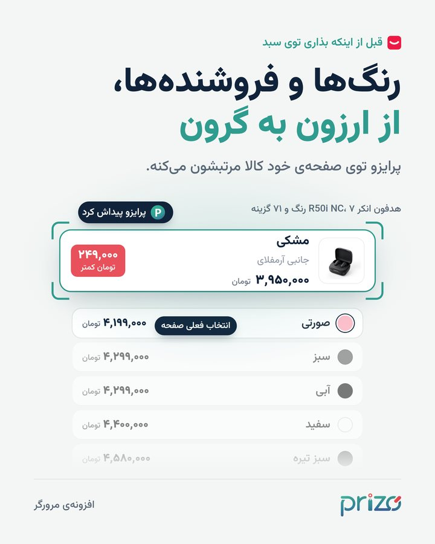

**چه فایده‌ای دارد؟** پیش از افزودن به سبد می‌دانید ارزان‌ترین گزینه کدام است.

#### معادل ساعت کار
درآمد و ساعت کار ماهانه را یک بار وارد می‌کنید و کنار قیمت کالاها می‌بینید برای خریدشان چند ساعت باید کار کنید.

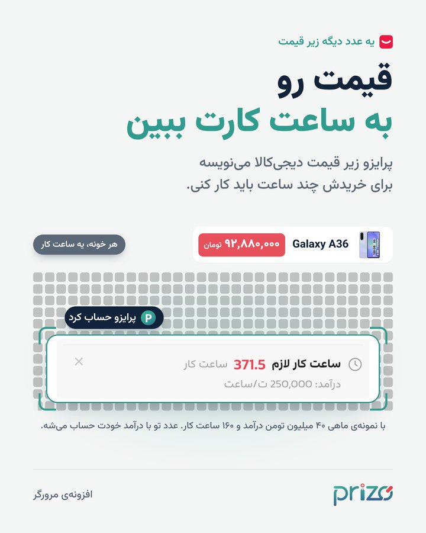

**چه فایده‌ای دارد؟** عددهای بزرگ تومان معنایشان را از دست می‌دهند. ساعت کار، هزینه را ملموس می‌کند.

#### فیلتر پیشرفته و مرتب‌سازی بر اساس تخفیف
در فهرست کالاهای دیجی‌کالا کلمه حذف کنید، بازهٔ تخفیف و حداقل امتیاز بگذارید یا کالاهای نزدیک کمترین قیمت ۳۰ روز را پیدا کنید. مرتب‌سازی بر اساس بیشترین تخفیف هم هست.

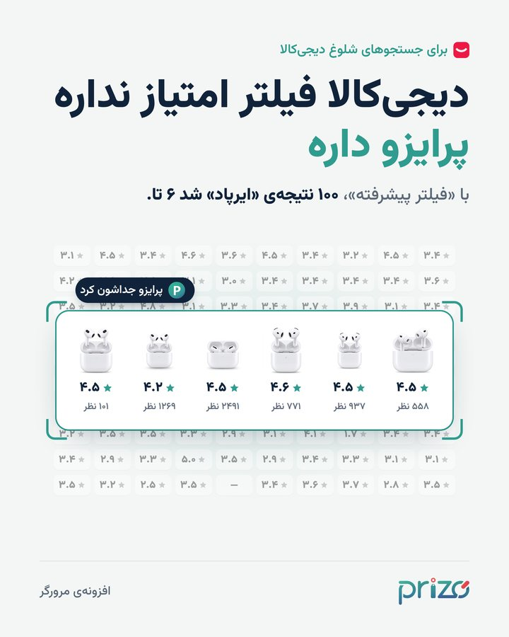

**چه فایده‌ای دارد؟** فهرست صدتایی به چند کالای قابل‌توجه کوچک می‌شود.

#### پایش شگفت‌انگیزها
حراج‌های دیجی‌کالا، دیجی‌کالا فرش، بانی‌مد، خانوم، تکنولایف و مدیسه را با شرط‌های خودتان (تخفیف، قیمت، برند، کلمه و موجودی) دنبال کنید. روی کارت‌ها می‌بینید کالا تازه وارد حراج شده یا چند روز است در آن است.

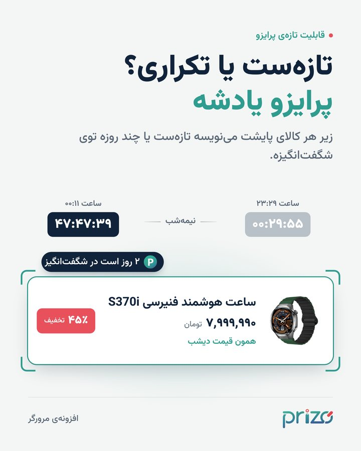

**چه فایده‌ای دارد؟** فقط حراج‌هایی به شما می‌رسد که به کارتان می‌آید.

#### پایش تخفیف سوپرمارکت
محل خودتان را انتخاب کنید تا فروشگاه‌های نزدیک پیدا شوند. پرایزو تخفیف **اسنپ‌مارکت**، **اکالا** و **هایپرمارکت دیجی‌کالا** را با شرط‌هایی که می‌گذارید بررسی می‌کند و وقتی کالای موردنظرتان تخفیف خورد خبرتان می‌کند.

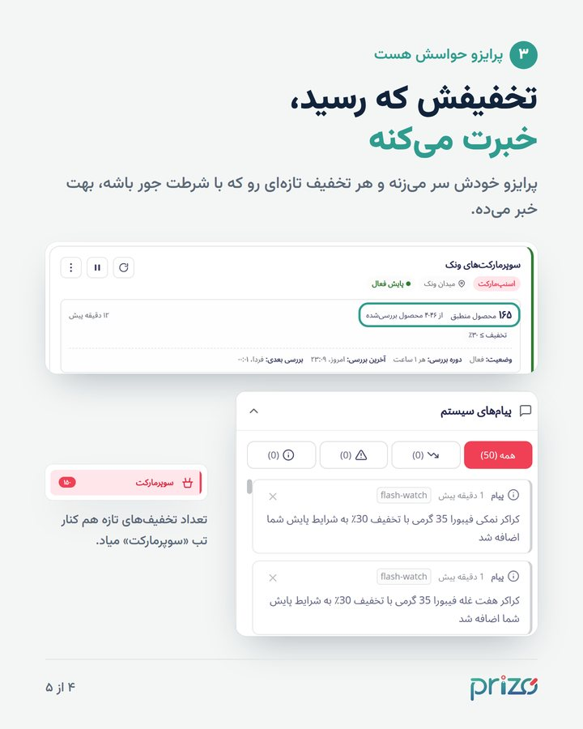

**چه فایده‌ای دارد؟** تخفیف‌های خواربار زود تمام می‌شود و هر ساعت سر زدن به چند اپلیکیشن شدنی نیست.

#### تحلیل سفارش‌ها
سفارش‌های دیجی‌کالای شما را جمع می‌زند: مجموع خرید، تخفیف‌هایی که واقعاً گرفته‌اید و روند خرج کردن در طول سال.

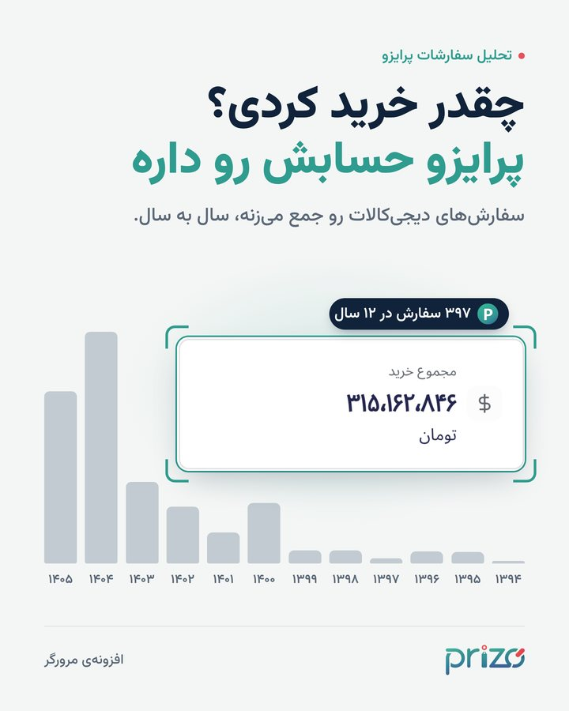

**چه فایده‌ای دارد؟** می‌دانید واقعاً چقدر خرج و چقدر صرفه‌جویی کرده‌اید.

---

## 📱 اپلیکیشن اندروید

پرایزو برای اندروید یک مرورگر مخصوص دیجی‌کالاست. دیجی‌کالا را داخل آن باز می‌کنید و یک دکمهٔ «P» روی صفحه‌ها می‌ماند. هر صفحه کارهای خودش را دارد: صفحهٔ کالا، جست‌وجو، شگفت‌انگیزها یا سبد خرید. خرید و پرداخت همان خرید دیجی‌کالاست.

**[⬇️ دریافت از گیت‌هاب (فایل APK)](https://github.com/zanasaed/prizo-extension/releases?q=android-v&expanded=true)** · [نصب از کافه‌بازار](https://cafebazaar.ir/app/ir.prizo.android)

<table dir="rtl">
<tr>
<td width="25%">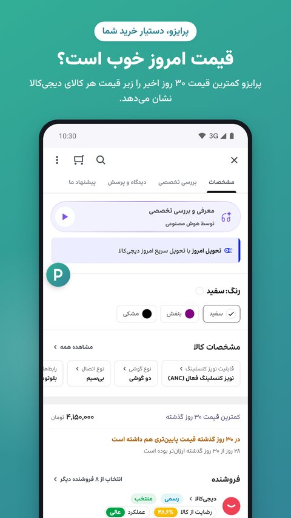</td>
<td width="25%">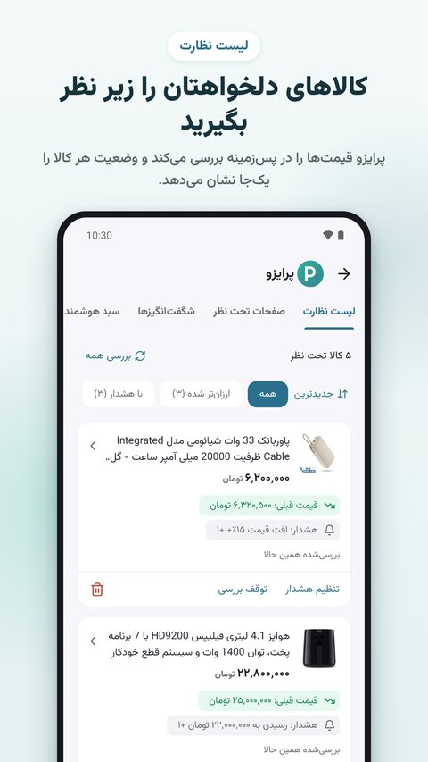</td>
<td width="25%">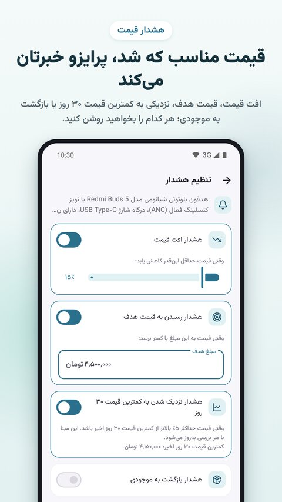</td>
<td width="25%">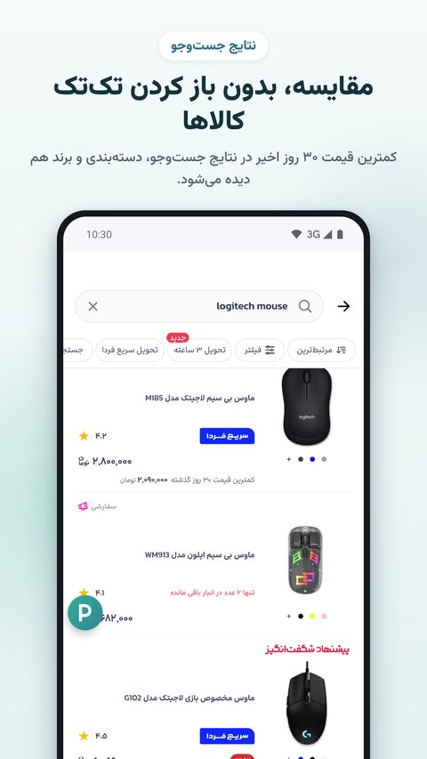</td>
</tr>
<tr>
<td width="25%">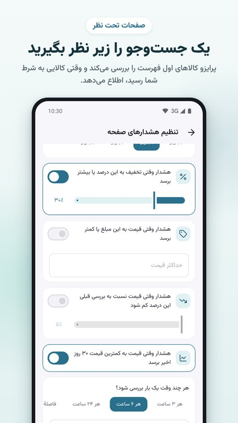</td>
<td width="25%">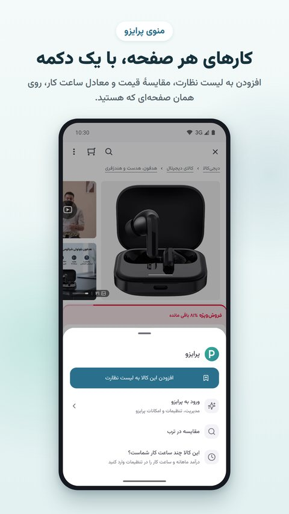</td>
<td width="25%">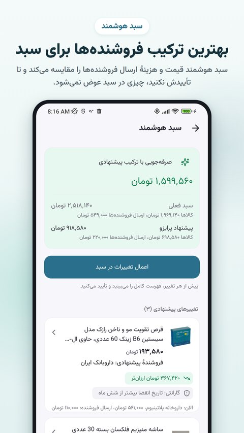</td>
<td width="25%">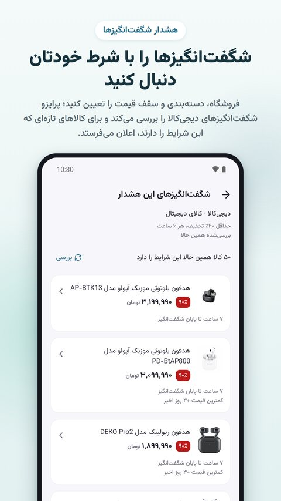</td>
</tr>
</table>

### چه امکان‌هایی دارد؟

- **کمترین قیمت ۳۰ روز اخیر** زیر قیمت هر کالا، همراه با یک جمله دربارهٔ قیمت امروز. همین عدد در نتایج جست‌وجو، دسته‌بندی و برند هم کنار هر کالا هست.
- **لیست نظارت و هشدار قیمت:** افت قیمت به درصد دلخواه، رسیدن به قیمت هدف، نزدیک شدن به کمترین قیمت ۳۰ روز، یا بازگشت کالا به موجودی. فاصلهٔ بررسی را خودتان انتخاب می‌کنید.
- **صفحات تحت نظر:** یک جست‌وجو، دسته‌بندی یا برند را زیر نظر بگیرید تا وقتی کالایی به شرط شما رسید خبر بگیرید.
- **هشدار شگفت‌انگیزها** برای دیجی‌کالا و دیجی‌کالا فرش، با حداقل تخفیف و سقف قیمتی که تعیین می‌کنید.
- **سبد هوشمند:** ترکیب ارزان‌تر فروشنده‌ها را پیشنهاد می‌دهد و با تأیید شما در سبد اعمال می‌کند.
- **مرتب‌سازی بر اساس بیشترین تخفیف**، **مقایسه در ترب** و **معادل ساعت کار** از منوی پرایزو در دسترس است.
- مبلغ هر قسط در خرید ۴ قسطی و کدهای تخفیف حساب شما هم در مرحلهٔ پرداخت نمایش داده می‌شود.
- از هر برنامه‌ای که لینک دیجی‌کالا دارد، با «اشتراک‌گذاری» می‌توانید صفحه را در پرایزو باز کنید.

### چطور نصب کنم؟

1. به [صفحهٔ نسخه‌های اندروید](https://github.com/zanasaed/prizo-extension/releases?q=android-v&expanded=true) بروید و آخرین نسخه را باز کنید.
2. فایل **APK** را از بخش «Assets» دانلود کنید.
3. فایل را باز کنید. اگر اندروید خواست، اجازهٔ نصب از همان برنامه‌ای را بدهید که فایل را با آن باز کرده‌اید (مثلاً مرورگر یا مدیریت فایل).
4. پرایزو نصب می‌شود و در فهرست برنامه‌ها پیدا می‌شود.

پرایزو به اندروید ۱۰ یا بالاتر نیاز دارد. نسخه‌های بعدی را هم از همین صفحه بگیرید و روی نسخهٔ قبلی نصب کنید.

اگر اعلان‌ها دیر می‌رسند: اندروید و بعضی گوشی‌ها (مثلاً شیائومی) بررسی در پس‌زمینه را محدود می‌کنند. در تنظیمات گوشی، برای پرایزو «شروع خودکار» را روشن کنید و صرفه‌جویی باتری را برایش بردارید.

---

## شروع کنید

1. **افزونه یا اپلیکیشن را نصب کنید.** با کامپیوتر از [فروشگاه کروم](https://chromewebstore.google.com/detail/prizo/badnjhkoepmmgmffcoloclogblcbomjb)، با گوشی از [گیت‌هاب](https://github.com/zanasaed/prizo-extension/releases?q=android-v&expanded=true).
2. **سراغ دیجی‌کالا بروید.** یک کالا را باز کنید. کمترین قیمت ۳۰ روز اخیر خودش کنار قیمت می‌آید و لازم نیست تنظیمی انجام دهید.
3. **کالای موردنظرتان را زیر نظر بگیرید.** اگر قیمت هنوز مناسب نیست، شرطتان را بگذارید و بگذارید پرایزو بپاید.
4. **پیش از پرداخت، سبد را بررسی کنید.** سبد هوشمند را امتحان کنید.

## راه‌های ارتباطی رسمی

| | |
|---|---|
| 🌐 وب‌سایت | [prizoai.ir](https://prizoai.ir) |
| ✈️ کانال آموزشی تلگرام | [@PrizoAi](https://t.me/PrizoAi)، آموزش و معرفی امکان‌های پرایزو |
| 🔥 کانال تخفیف‌های روزانه | [@Prizo_Deals](https://t.me/Prizo_Deals)، تخفیف‌ها و فرصت‌های خرید فروشگاه‌های پشتیبانی‌شده |
| 💬 ارتباط مستقیم با پرایزو | [@PrizoAI1](https://t.me/PrizoAI1)، گزارش مشکل، پرسش و پیشنهاد |
| 📸 اینستاگرام | [@prizoai](https://www.instagram.com/prizoai) |
| 🧩 افزونهٔ مرورگر | [فروشگاه کروم](https://chromewebstore.google.com/detail/prizo/badnjhkoepmmgmffcoloclogblcbomjb) |
| 📱 اندروید | [نسخه‌های گیت‌هاب](https://github.com/zanasaed/prizo-extension/releases?q=android-v&expanded=true) · [کافه‌بازار](https://cafebazaar.ir/app/ir.prizo.android) |

---

پرایزو برنامه‌ای مستقل است و به دیجی‌کالا یا فروشگاه‌های دیگر تعلق ندارد. سیاست حفظ حریم خصوصی را [اینجا](PRIVACY.md) بخوانید. پرایزو را دوست دارید؟ می‌توانید از [این صفحه](https://www.coffeebede.com/zanasaed) حمایتش کنید.

